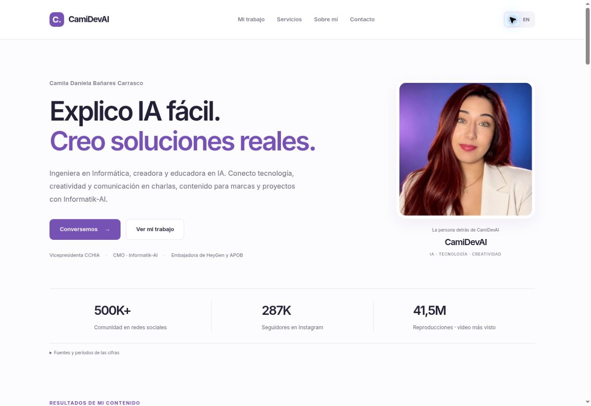
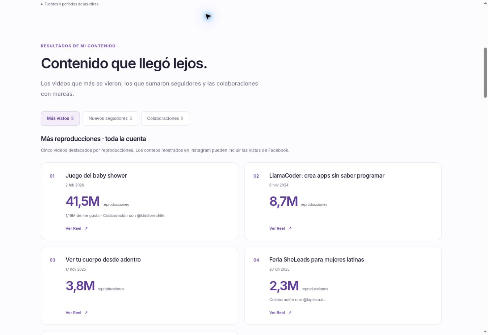

# CamiDevAI · Media Kit

Sitio estático de **Camila Daniela Bañares Carrasco**. Diseño claro y minimalista,
con español e inglés, publicaciones verificadas, servicios, trayectoria y contacto.

## Archivos

- `index.html`: contenido en español listo para renderizar sin JavaScript.
- `assets/css/styles.css`: diseño adaptable, fondo claro y tipografía Inter.
- `assets/js/config.js`: perfil, cifras, fuentes, contenido destacado y EmailJS.
- `assets/js/translations.js`: textos en ambos idiomas.
- `assets/js/main.js`: selección de idioma y formulario de contacto.
- `content/featured.json`: publicaciones recientes y fechas de revisión.
- `content/services.json`: perfil, servicios y fotografía incorporados desde la página de CamiDevAI.
- `content/performance.json`: rankings actuales proporcionados por la titular y sus alcances.
- `content/performance-2025.json`: los once registros históricos conservados.
- `content/sources/rankings-2026-10-12.md`: cifras, enlaces y notas originales compartidos por CamiDevAI.
- `assets/images/`: retrato y portadas descargadas de publicaciones públicas de la titular.

## Uso local

```bash
python -m http.server 8000
```

No requiere compilación. GitHub Pages publica la rama `main`.

## Revisión del 12 de octubre de 2026

El perfil profesional se contrastó con https://www.linkedin.com/in/camilabanares/.
La vicepresidencia de la CCHIA también aparece en el sitio de Expo Mercado Público:
https://www.expomercadopublico.cl/s/speakers/.

Se revisó el perfil público https://www.instagram.com/camidevai/ y se abrieron las
seis publicaciones incluidas en `content/featured.json`, comprobando autoría,
fecha, contenido y portada. La selección es editorial: no se presenta como un ranking
de rendimiento. Los conteos de visualizaciones recientes no eran visibles y no se inventaron.

Las miniaturas se guardaron como archivos del sitio para evitar depender de URLs
temporales del CDN de Instagram. Las portadas conservan su imagen original.

La comunidad de **500K+** es un dato declarado en LinkedIn. Instagram mostró
**287 mil seguidores**, una cifra pública redondeada.

## Perfil, servicios y retrato

La foto `1791462946725.jpg`, adjuntada por CamiDevAI, aparece como retrato principal
y como imagen para compartir el enlace. Se conservan sus bytes originales.

La página https://camidevai.github.io/camidevai-prochechando/ aporta cuatro formas
de colaboración: charlas y conferencias; cursos y talleres; videos para marcas,
lugares y experiencias; y proyectos con el equipo de Informatik-AI. El perfil
precisa el rol de **cofundadora y CMO**, a cargo de marketing, marca y comunicación.
La fuente y el commit están documentados en `content/sources/services-2026-10-12.md`.
El botón de contacto enlaza al calendario público de la página de referencia.
No se crean reservas ni se envían mensajes durante la revisión.

## Rankings proporcionados por la titular

CamiDevAI compartió los datos el **12 de octubre de 2026** (America/Santiago).
La página presenta tres rankings: cinco videos por reproducciones de toda la
cuenta, cinco por seguidores ganados en Instagram desde fines de julio de 2026,
y seis colaboraciones por reproducciones. El video del baby shower encabeza las
reproducciones con **41,5M**; ChatGPT + Canva encabeza seguidores con **≈3.300**.

Los conteos mostrados en Instagram pueden incluir Facebook. En ChatGPT + Canva,
**1,35M** es el total mostrado y **947K** corresponden a Instagram. Los seguidores
son exclusivos de Instagram. Las aproximaciones mantienen el símbolo ≈. La
colaboración con @kidstorechile no tiene remuneración confirmada. LlamaCoder,
ChatGPT + Canva e InVideo AI aparecen como menciones sin colaboración pagada.

Estos datos son **proporcionados por la titular**, no extraídos ni verificados
independientemente por el asistente en Insights. Cada ranking conserva su alcance
y el enlace del video. Los Reels entregados sin título se identifican por su fecha.
No se inventó un enlace para InVideo AI.

Los once resultados de 2025 permanecen en un archivo plegable y en
`content/performance-2025.json`. Las cifras históricas no reemplazan las actuales.
`CONFIG.historicalContent` conserva el registro original y
`CONFIG.archivedPerformanceContent` conserva el manifiesto histórico anterior.
La página no consulta ni sincroniza Insights automáticamente.

Se mantiene la configuración existente del formulario de EmailJS. El correo y LinkedIn
siguen disponibles como contacto directo. La revisión del sitio no envía correos reales.

## Vista previa





## Revisión comercial del 29 de octubre de 2026

El media kit se reorientó a equipos de marketing, agencias de PR y marcas tecnológicas.
Se incorporaron una apertura orientada a campañas y cuatro modalidades de colaboración:
pruebas y préstamos de productos, cobertura de lanzamientos y eventos, campañas pagadas,
y embajadurías. Se añadieron tarjetas de los cuatro perfiles públicos aportados por Camila:
Instagram, TikTok, Facebook y LinkedIn; se corrigió el destino del enlace de Facebook.
La portada y el contacto facilitan ahora las propuestas comerciales, y se mantienen
las traducciones ES/EN y la accesibilidad de la navegación.

No se modificaron las cifras existentes ni sus fechas y notas metodológicas
(12 de octubre de 2026), al no contar con nuevos Insights. Las modalidades nuevas
son oportunidades ofrecidas a marcas, no afirmaciones sobre contratos concretos.
La política editorial distingue la prueba de productos de un respaldo comercial
obligatorio e invita a identificar las campañas pagadas.

## Instagram Insights recibidos el 29 de octubre de 2026

Se incluyó una sección de audiencia y rendimiento reciente enfocada a agencias
tecnológicas. Los datos provienen de seis capturas de Instagram Insights aportadas
por la titular. Se documentan de forma estructurada en
`content/insights-2026-10-29.json`; las capturas originales permanecen privadas.

- Últimos 30 días: 3.105.291 reproducciones; 759.128 espectadores; +2.292 seguidores netos.
- Principales países: Chile 44,7%; México 11,0%; Argentina 7,9%; Venezuela 7,8%; Colombia 6,4%.
- Género: hombres 60,3%; mujeres 39,7%.
- Edad: 25–34 (21,5%), 35–44 (36,3%) y 45–54 (25,2%); suma 25–54 = 83,0%.
- Idioma español: 97,6%.

La gráfica de reproducciones de Instagram expresa los últimos 30 días y las
cifras demográficas proceden de la pestaña Público. La sección incluye advertencia
de fuente y evita extrapolar datos de Instagram a todas las redes. Las cifras
históricas existentes se conservan con su fuente y fecha de referencia anteriores.
